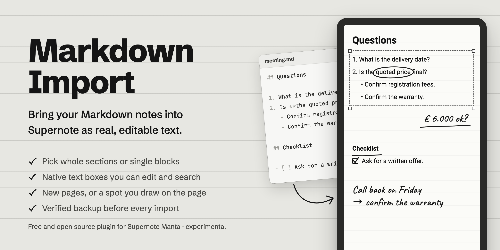

<p align="center">
  
</p>

<p align="center">
  <a href="https://github.com/schaefer-dev/supernote_markdown_plugin/releases/latest"></a>
  
  
  <a href="LICENSE"></a>
</p>

Markdown Import is a Supernote plugin that puts sections of your Markdown files into a notebook as native, **editable text boxes**. Prepare an agenda, a checklist or reference notes on your computer, import the parts you need, and write by hand right next to them.

Everything happens on the tablet. The plugin reads Markdown files that are already on the device and doesn't connect to your computer, Obsidian or any cloud service. Each import is a snapshot: later changes to the Markdown file don't update the notebook, and edits in the notebook don't change the Markdown file.

> [!WARNING]
> **Version 0.1.0 is experimental.** It targets the **Supernote Manta** with firmware **Chauvet 3.30.45**. Desktop builds and tests pass, but the checks on a real tablet (editing, saving, restarting, syncing) haven't been completed yet. Progress is tracked in the [device acceptance checklist](docs/DEVICE_ACCEPTANCE.md). The plugin makes a verified backup before every import, but keep your own backup of any notebook you care about.

## Install

1. Download the `.snplg` file from the [latest release](https://github.com/schaefer-dev/supernote_markdown_plugin/releases/latest). Its SHA-256 checksum is published next to it.
2. Copy it to the `MyStyle` folder on your Supernote.
3. On the tablet, open **Settings → Apps → Plugins → Add Plugin** and select the file. The package contains a small Android bridge, so always install the complete `.snplg`.

## Usage

1. Copy a UTF-8 `.md` file (up to 1 MB) into the tablet's `Document` folder, e.g. `Document/Markdown`. USB, Browse & Access or your usual sync setup all work.
2. Open a notebook and tap **Import Markdown** in the toolbar. Allow file access when asked.
3. Choose a Markdown file. Tap individual blocks, or **Whole section** to include a heading and everything beneath it. Nothing is selected by default; **Select all** is available.
4. Choose where the text goes:
   - **New pages after this page**, or
   - **Area on this page**: draw a rectangle on the page preview. Drag again to adjust it.
5. Pick a text size, check the page preview and tap **Insert**.
6. Back in the notebook, edit the text with the normal Supernote text tools and add handwriting around it.

Synced notebooks open on a Mac with [Supernote Viewer](https://github.com/schaefer-dev/supernote-viewer).

## What gets imported

| Markdown | In the notebook |
| --- | --- |
| Headings | Larger, bold text boxes |
| Paragraphs | Editable text boxes |
| Bold or italic paragraphs | Kept |
| Bold or italic words within a paragraph | Words kept, styling removed |
| Numbered, bulleted and nested lists | Text markers and indentation |
| Tasks (`- [ ]`, `- [x]`) | Checkbox characters, editable as text |
| Quotes | Italic text boxes |
| Code blocks | Whitespace kept, in the system font |
| Links and Obsidian `[[wikilinks]]` | Link labels and aliases as plain text |
| Tables | Plain rows separated by ` \| ` |
| Images and Obsidian attachment embeds | Left out, with a notice |
| YAML frontmatter | Left out |

The preview explains anything that will be simplified or left out before you insert.

**Layout.** New pages use a blank template with 5% margins. Body text is sized relative to the page width, with smaller and larger presets and scaled headings. Long blocks can be split into several text boxes across new pages. One import can add up to 100 pages. The preview closely approximates, but doesn't exactly match, how the tablet renders text.

**Inserting on an existing page.** The selected text must fit completely in the rectangle you draw. Pick empty space: imported text can overlap handwriting if you choose an occupied area. The plugin never moves handwriting, and other content doesn't reflow when you later edit the text.

## Backups and recovery

Before the first insertion, the plugin saves the notebook and writes a hash-verified copy to **EXPORT/Markdown Import Backups**. It records its progress before each step and reads the saved page back before reporting success.

If an import fails or the plugin closes unexpectedly, some text may already be in the notebook. The next time you open the plugin, it shows the backup's location, how many pages were verified and the last unfinished step. Review the notebook before importing again. The plugin never retries or restores anything automatically.

To restore, first keep a copy of the current notebook, then copy the backup into your `Note` folder with the tablet's file manager or from your computer. The backup predates the import, so it won't contain handwriting added afterwards. Delete old backups yourself in Files. Supernote's Undo works for live text insertion, but a single Undo won't reverse a multi-page import.

## Feedback

This is an early release for one device and firmware. If you try it on a Manta or another model, please [open an issue](https://github.com/schaefer-dev/supernote_markdown_plugin/issues) with your model, firmware version and what happened. A synthetic Markdown file that reproduces the problem helps a lot; please don't attach personal notes.

<details>
<summary><b>For developers: building, packaging and project layout</b></summary>

### Build

Based on the official Supernote plugin template **1.0.13**, React Native **0.79.2** and `sn-plugin-lib` **0.2.3**. Dependency versions are pinned in `package-lock.json`.

Requirements: Node LTS (22 or 24), npm, JDK 21, Android SDK Platform 35, Build Tools 35.0.0, NDK 27.1.12297006 and CMake 3.22.1. Android Studio's SDK Manager can install the Android components. Python 3, Bash and ZIP utilities are needed for packaging.

```sh
npm ci
npm run typecheck
npm test
JAVA_HOME=$(/usr/libexec/java_home -v 21) \
ANDROID_HOME="$HOME/Library/Android/sdk" npm run build
```

On other systems, point `JAVA_HOME` and `ANDROID_HOME` at your local installations. A local, git-ignored `.toolchain-env` can export these variables; no global Java change is needed.

The build follows the official `buildPlugin.sh` workflow with two fixes: native packaging failures stop the build, and stale output is removed before packaging. `scripts/verify-package.py` then checks the manifest, ReactPackage registration, JavaScript bundle and Android DEX classes. The verified installer and its SHA-256 checksum are written to `dist/`.

See [BUILD_VALIDATION.md](docs/BUILD_VALIDATION.md) for what desktop checks establish, and [DEVICE_ACCEPTANCE.md](docs/DEVICE_ACCEPTANCE.md) for what still needs a real tablet.

### Layout

- `src/core/`: Markdown parsing, section selection, layout and pagination, and the sequential import process. No SDK calls.
- `src/platform/`: the official SDK adapter (`supernote.ts`) and the typed Android bridge (`bridge.ts`).
- `src/ui/`: page previews and area selection. `App.tsx` contains the import workflow.
- `android/app/`: UTF-8 and private-file access and Android text measurement, bundled into the plugin's native package. The bridge measures text with an installed Roboto or Noto Sans system font and passes the same font to the tablet's text box.
- `fixtures/meeting.md`: synthetic test input. Personal Markdown files and notebooks are never committed.
- `docs/hero/`: source of the README banner (`render.sh` regenerates it).

### Supernote Viewer

[Supernote Viewer](https://github.com/schaefer-dev/supernote-viewer) is the companion macOS app that renders the saved notebooks. Changes that affect text, layout or pages should be checked there too. Note that Android SDK page dimensions can differ from the pixel dimensions stored in the notebook; the plugin always uses the SDK's `getPageSize`. [CLAUDE.md](CLAUDE.md) documents the conventions shared by both projects.

### Supernote SDK references

- [Plugin setup](https://docs.supernote.com/en/first-plugin)
- [Inserting editable text](https://docs.supernote.com/en/api-reference/supernote-plugin/plugin-note-api/insert-text)
- [Saving before file operations](https://docs.supernote.com/en/api-reference/supernote-plugin/plugin-note-api/save-current-note)
- [Plugin permissions](https://docs.supernote.com/en/plugin-base/permission)

</details>

## License

[MIT](LICENSE). The scaffold and packaging script come from the MIT-licensed official Supernote plugin template; see [third-party notices](THIRD_PARTY_NOTICES.md). Not affiliated with Ratta or Supernote.
